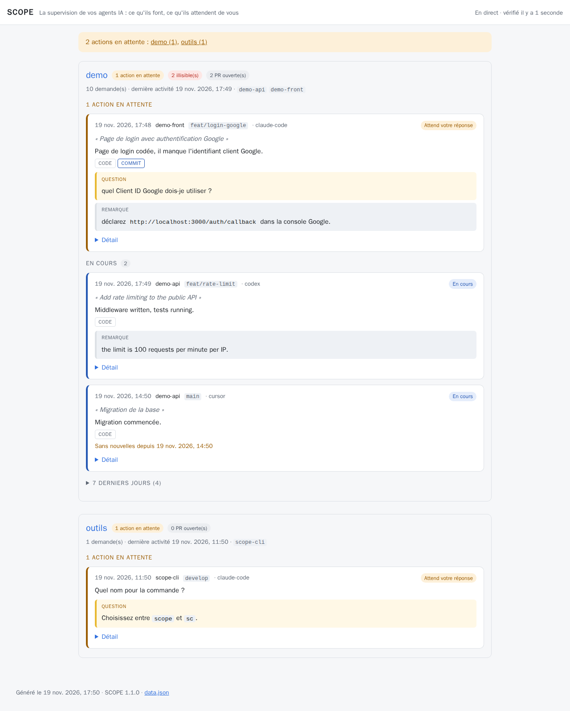

# SCOPE

**Supervision, Coordination & Observation Platform Engine** · [English](README.md)

SCOPE vous guide **pendant que vous travaillez** entre toutes les demandes faites à vos agents IA de code (Claude Code, Cursor, Copilot, Codex…). Pour chaque demande, une page montre :

- **ce que vous avez demandé** ;
- **ce que l'agent a fait** : code, commit, push, PR, déploiement, selon ce que vous lui avez autorisé ;
- surtout, **ce que l'agent attend de vous** : une question, une décision, ou une remarque à connaître.

> *« Crée une page de login avec Google. »* SCOPE montre que l'agent attend une réponse (*« Quel Client ID ? »*) et fait une remarque (*« Google exige l'URL de retour http://localhost:3000/auth/callback »*).

<picture>
  <source media="(prefers-color-scheme: dark)" srcset="docs/img/accueil-sombre.png">
  
</picture>

## Démarrage

Prérequis : `git`, et Docker avec Compose, ou Python ≥ 3.12 sans Docker.

```bash
git clone https://github.com/thomdlnn/scope-2.0.git scope && cd scope
./scope.sh init mon-projet ~/Git/mon-app ~/Git/mon-api --lang fr   # une fois par dépôt
./scope.sh up                                                    # http://localhost:8080
```

Demandez ensuite quelque chose à votre agent dans `mon-app`. La demande apparaît en moins de 3 secondes, sans recharger la page.

`init` n'écrit rien sur GitHub et ne commite rien. Dans chaque clone, il :
1. ajoute la consigne SCOPE dans `CLAUDE.md` et `AGENTS.md`, entre `<!-- scope:start -->` et `<!-- scope:end -->` (relancez-le pour la mettre à jour). Vous décidez de commiter ces fichiers ou non ;
2. ajoute `.scope/` à `.git/info/exclude` : les rapports ne sont jamais commités ;
3. écrit le nom du projet dans `.scope/projet` ;
4. installe un hook Claude Code dans `.claude/settings.local.json` (voir [le hook](#le-hook-claude-code)).

`--lang fr` donne une consigne en français (par défaut : `en`).

| Commande | Rôle |
| --- | --- |
| `./scope.sh init <projet> <clone>... [--lang en\|fr]` | Installe ou met à jour SCOPE dans des clones locaux |
| `./scope.sh up` / `down` / `logs` | Lance, arrête, suit SCOPE (Docker Compose) |
| `./scope.sh apercu` | Même page sans Docker (Python seul), sur http://localhost:8000 |

| Réglage (environnement ou `.env`) | Défaut | Rôle |
| --- | --- | --- |
| `SCOPE_ROOT` | `~/Git` | Dossier où chercher les dépôts, monté **en lecture seule** |
| `SCOPE_DEPTH` | `4` | Nombre de niveaux de dossiers parcourus sous `SCOPE_ROOT` |
| `SCOPE_INTERVAL` | `3` | Secondes entre deux lectures des rapports |
| `SCOPE_PORT` | `8080` | Port local de la page (sur 127.0.0.1) |
| `SCOPE_GH_TOKEN` | — | Token GitHub optionnel, en lecture seule ([voir plus bas](#optionnel--un-token-github)) |
| `SCOPE_GH_INTERVAL` | `60` | Secondes entre deux lectures de l'API GitHub |

## Fonctionnement

```
vos clones (SCOPE_ROOT, lecture seule)     générateur (toutes les 3 s)            nginx
~/Git/.../mon-app/.scope/rapports/*.md ──▶ lit les rapports, groupe par projet ──▶ http://localhost:8080
         ▲                                 écrit un site statique, bascule         │
         └── écrits par vos agents         d'un coup seulement s'il a changé       ▼
                                                                   la page relit etat.json
                                                                   et se met à jour seule
```

- **Les rapports ne sont pas commités.** Ils servent au suivi en direct ; les commits font déjà l'historique. Ils vivent dans `.scope/rapports/` de votre clone local, exclus de git.
- **SCOPE lit les rapports sur votre disque, pas sur GitHub.** Il ne voit donc que les agents qui tournent sur votre machine. C'est voulu : les rapports ne demandent ni token ni réseau.
- **Ni IA, ni base de données, ni serveur applicatif.** Un script Python écrit un site statique, nginx le sert.
- **Universel.** Tout agent capable de suivre une consigne écrite convient : le contrat est un fichier Markdown.
- **En direct.** La page relit `etat.json` toutes les quelques secondes et remplace son contenu quand quelque chose change, en gardant vos filtres et les sections dépliées. L'en-tête indique la dernière lecture des rapports et passe en orange si la génération semble arrêtée.

L'**accueil** annonce d'abord le nombre d'**actions en attente** (« Aucune action en attente », sinon « 2 actions en attente : mon-projet (1), … »), puis montre **un bloc par projet**, ceux qui attendent quelque chose en premier : les questions en attente (avec le dépôt et la demande), les demandes **en cours** (signalées quand l'agent n'a rien mis à jour depuis une heure) et, repliées, celles des **7 derniers jours**. La **page d'un projet** reprend ces blocs, avec des filtres par dépôt et par statut, le détail dépliable et les actions en badges.

## Le rapport

Un fichier **par demande**, créé au début du travail et **mis à jour** jusqu'à la fin : `.scope/rapports/AAAA-MM-JJ-HHMMSS-<slug>.md`. La consigne complète donnée aux agents est dans [templates/instructions-ia.fr.md](templates/instructions-ia.fr.md).

```markdown
---
projet: mon-projet
repo: mon-app
agent: claude-code
branche: feat/login-google
demande: "Page de login avec authentification Google"
statut: attente            # en-cours | attente | termine | echec
actions: [code, commit]    # code | commit | push | pr | deploy | hors-depot
debut: 2026-11-17T10:30:00Z
maj: 2026-11-17T10:42:00Z
pr: 42                     # optionnel
---

## Résumé
Une ligne : où en est la demande.

## Pour vous
- Question : quel Client ID Google dois-je utiliser ?
- Remarque : déclarez http://localhost:3000/auth/callback dans la console Google.

## Détail
Fichiers modifiés, choix techniques, tests lancés.
```

- `attente` ⇔ au moins une `Question :` dans *Pour vous*. Une remarque seule ne met pas en attente. SCOPE affiche un avertissement si les deux ne concordent pas.
- Quand vous répondez, l'agent continue dans **le même fichier**. Nouvelle demande = nouveau fichier.
- Clés et titres acceptés **en français et en anglais** : `projet`/`project`, `statut`/`status`, `demande`/`request`, `branche`/`branch`, `debut`/`started`, `maj`/`updated` ; `Résumé`/`Summary`, `Pour vous`/`For you`, `Détail`/`Details` ; `en-cours`/`in-progress`, `attente`/`waiting`, `termine`/`done`, `echec`/`failed`.
- **Projet :** le champ `projet`, sinon `.scope/projet`, sinon le nom du dossier du dépôt.
- **L'ancien format** (un rapport par réponse) reste lu : `bloque` = `attente`, `pr-ouverte` = `termine` avec une PR, « Résumé court » = résumé, « Prochaine étape » = *Pour vous*. Un ancien rapport `bloque` ne compte comme attente que tant qu'il est le rapport le plus récent de son dépôt.
- **Un rapport mal formé** s'affiche « illisible », avec la raison, et ne casse jamais la page.
- **Jamais** de secret, token, mot de passe ni donnée personnelle dans un rapport.

### Le hook Claude Code

Il arrive qu'un agent oublie son rapport. Pour Claude Code, `init` installe deux hooks dans `.claude/settings.local.json` (non commité), appuyés sur `.scope/hooks/scope_hook.py` :
- quand vous envoyez un prompt (`UserPromptSubmit`), il note l'état du dépôt ;
- quand l'agent termine son tour (`Stop`), si des fichiers du dépôt ont changé (ou si un commit a été fait) et qu'aucun rapport n'a été créé ou mis à jour pendant le tour, il bloque **une fois** avec un rappel. Il s'appuie sur `stop_hook_active` pour ne jamais bloquer deux fois de suite.

Les autres agents s'appuient sur la consigne d'`AGENTS.md`.

## Optionnel : un token GitHub

Sans token, SCOPE ne fait aucun appel réseau. Avec un token GitHub **en lecture seule**, chaque page projet gagne un panneau **Dépôts** :

- les dépôts sont **déduits des clones** (`git remote get-url origin`), sans liste à écrire. D'éventuels identifiants dans l'URL du remote ne sont jamais affichés ;
- pour chaque dépôt : **toutes les pull requests ouvertes** (par n'importe qui, brouillons signalés) et le dernier commit de la branche par défaut ;
- l'accueil indique le nombre de PR ouvertes par projet.

```bash
cp .env.example .env    # puis renseignez SCOPE_GH_TOKEN=…
./scope.sh up
```

Créez un [token *fine-grained*](https://github.com/settings/personal-access-tokens/new) avec accès aux dépôts de vos projets, **Contents : Read-only** et **Pull requests : Read-only**, et une date d'expiration. C'est le seul token de SCOPE. GitHub est lu en tâche de fond toutes les `SCOPE_GH_INTERVAL` secondes (défaut 60) : les rapports locaux continuent d'apparaître toutes les 3 secondes, même si GitHub est lent. Les erreurs de token s'affichent sur la page : *dépôt introuvable avec ce token* (ajoutez le dépôt au token), *PR non lues* (ajoutez la permission Pull requests), *token refusé* (invalide ou expiré).

### Version déployée et santé de l'application (optionnel)

`projects/<projet>.yml` (le nom du fichier est le nom du projet) ajoute ce qui ne peut pas être déduit :

```yaml
deploiements:                                  # demande le token
  <owner>/mon-app:                             # dépôt applicatif
    depot: <owner>/mon-app-deploy              # dépôt GitOps (suivi par ArgoCD par exemple)
    fichier: environments/local/mon-app.yaml
    cle: image.tag                             # défaut : image.tag (SHA du commit construit)
    environnement: local                       # défaut : local
sante: http://mon-app.local/health             # appelée par le navigateur, sans token
```

- **`deploiements`** : SCOPE lit la version déclarée dans le dépôt GitOps et compte les commits de la branche par défaut pas encore déployés.
- **`sante`** : le navigateur appelle cette URL toutes les 60 secondes et comprend `{"status": "ok", "services": {…}, "versions": {"mon-app": "<sha>"}}`. L'application doit autoriser CORS (`Access-Control-Allow-Origin`), sinon l'état s'affiche « injoignable ».

Un fichier invalide est signalé sur l'accueil et ignoré ; le reste de la page fonctionne.

## Développement

```bash
python3 -m venv generator/.venv && generator/.venv/bin/pip install -r generator/requirements-dev.txt
(cd generator && .venv/bin/python -m pytest -q)        # tests
scripts/verifier-site.sh                              # Chromium headless (Docker), captures dans out/captures/
PYTHONPATH=generator generator/.venv/bin/python -m scope_gen --racine ~/Git --out site   # génération ponctuelle
```

```
scope.sh                    point d'entrée (init, up, down, logs, apercu)
docker-compose.yml          générateur + nginx ; Dockerfile, docker/nginx.conf
templates/                  consigne des agents (en, fr) et hook Claude Code
generator/scope_gen/
  demandes.py               rapport → demande (parser bilingue, ne lève jamais d'exception)
  locale.py                 trouve les dépôts sur le disque, regroupe par projet
  render.py, templates/, static/   HTML, CSS et JavaScript écrits à la main
  cli.py                    génération ponctuelle, boucle avec bascule atomique, serveur d'aperçu
  admin.py                  ./scope.sh init
  sources/depots.py, backends/   état des dépôts via l'API GitHub (token optionnel)
  config.py                 réglages optionnels projects/*.yml
```

## Hors périmètre

Roadmap, consommation de tokens, notifications, Kubernetes, GitHub Actions.

## Contribuer

Les issues et les pull requests sont bienvenues. Toute modification de `main` passe par une pull request, et la CI (tests, vérification navigateur, shellcheck, image Docker) doit passer.

## Licence

[MIT](LICENSE)
