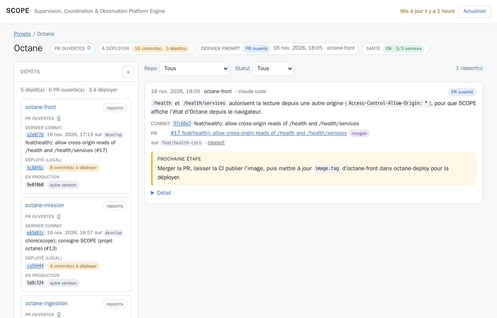

# SCOPE

**English** · [Français](README.fr.md)

**Supervision, Coordination & Observation Platform Engine**

SCOPE shows, project by project, what AI coding assistants (Claude Code, Cursor, GitHub Copilot, Codex…) did on your GitHub repositories.

At the end of each prompt, the assistant writes a short Markdown report to `.scope/rapports/` in the repository. SCOPE reads these reports with **a read-only token** and publishes one page per project:
- **a header bar**: open pull requests, commits waiting to be deployed, status of the last prompt, application health;
- **the report feed**: what was done, with which commit and pull request, and what is left to do;
- **per repository**: open pull requests, last commit, deployed version and the version actually running.

<picture>
  <source media="(prefers-color-scheme: dark)" srcset="docs/images/scope-dark.png">
  
</picture>

> The interface and the report format are in French for now.

## Principles

- **Simple.** A project name and a token are all it takes to add a project.
- **Read-only.** SCOPE's token only reads the project's repositories.
- **Lightweight.** No database, no application server, no AI inside SCOPE: a generator builds a static site, served by nginx.
- **Universal.** Works with any assistant that can follow written instructions: the contract is a Markdown file.
- **Verified.** SCOPE does not trust references written by the AI: it looks up the commit and the pull request through the GitHub API.

## Your copy, your data

**This repository only holds the code.** SCOPE never sends or stores anything here: your projects (`projects/*.yml`), your tokens and the generated page stay in **your** copy.

| Mode | Copy to use | Where your data lives |
| --- | --- | --- |
| **Local** (Docker Compose) | a plain `git clone` of this repository | on your machine: `projects/*.yml` and `.env` are git-ignored, nothing is pushed |
| **Kubernetes** (GitHub Actions) | **your own private repository**: **Use this template**, then *Private* | in your private repository: project files, Actions secrets, `scope-site` branch |

> **Do not fork this repository for the Kubernetes mode.** A fork of a public repository is public: the `scope-site` branch would publish your reports, pull request titles and repository names. Use **Use this template** (or push a clone to a new private repository).

To get new versions: `git pull` in local mode. For a copy created from the template, add this repository as an `upstream` remote and merge `upstream/main`.

## Quick start (Docker Compose)

Requirements: Docker with Compose, `python3` (≥ 3.12) and [`gh`](https://cli.github.com/) logged in (`gh auth login`).

```bash
git clone https://github.com/thomdlnn/scope-2.0.git scope && cd scope
./scope.sh init shop --env     # 1 read-only token, pick the repositories, AI instructions added
./scope.sh up                  # http://localhost:8080
```

`init`:
1. **asks for a GitHub token** with read access, without echoing it ([see below](#the-token));
2. **lists the repositories** this token can read, and lets you pick the project's ones;
3. **writes the token** to `.env` (never committed) and the project to `projects/shop.yml`;
4. **adds the SCOPE instructions** to `CLAUDE.md` and `AGENTS.md` in each repository, through a pull request opened with *your* `gh` credentials, never with the token.

Merge these pull requests. Reports then show up as you prompt.

The generator runs in a container and rebuilds the page every 15 minutes. nginx serves it on `127.0.0.1:8080`.

| Command | What it does |
| --- | --- |
| `./scope.sh init <project>` | Adds or updates a project (`--env`: Docker Compose mode) |
| `./scope.sh consigne <project>` | Adds or updates the AI instructions in a project's repositories |
| `./scope.sh up` / `down` / `logs` | Starts, stops or follows SCOPE locally |
| `./scope.sh refresh` | Rebuilds the page now |
| `./scope.sh apercu` | Builds the page once, without Docker, and serves it on http://localhost:8000 |
| `./scope.sh cluster` | Installs SCOPE on a Kubernetes cluster with ArgoCD |

Useful `init` options:

| Option | Effect |
| --- | --- |
| `--env [FILE]` | Docker Compose mode: token written to `.env` (default) instead of a GitHub secret |
| `--titre "Shop"` | Displayed project title |
| `--repos o/a,o/b` | Fixed repository list, no selection prompt |
| `--token-dedie` | Token for this project only (see below) |
| `--clones ~/src` | Writes the instructions directly into your local clones (`~/src/<repo>`), no pull request |
| `--dry-run` | Sends nothing: no secret, no push, no pull request |

### The token

Create a [*fine-grained* token](https://github.com/settings/personal-access-tokens/new):
- **Repository access:** *Only select repositories*, choosing the project's repositories. Add the GitOps repository if you display the deployed version;
- **Permissions:** **Contents: Read-only** and **Pull requests: Read-only** (Metadata: Read-only is added automatically);
- **Expiration:** set an expiration date.

**One token for everything, or one per project.** The first token becomes the global token, `SCOPE_GH_TOKEN`, which must then read the repositories of every project. To isolate projects, `--token-dedie` stores a project-specific token, `SCOPE_TOKEN_<PROJECT>`. If a global token already exists, `init` offers this choice.

### Refresh

The page is rebuilt **every 15 minutes** (`SCOPE_INTERVAL` in `.env`). To go faster:
- the **Actualiser** button at the top of each page reloads the current page with the latest generated data, keeping your filters;
- `./scope.sh refresh` triggers a new build right away.

The header shows how long ago the page was updated. After 30 minutes it turns orange: the build is probably failing, for example because of an expired token.

## The report

At the end of each prompt that changes code, the assistant creates `.scope/rapports/YYYY-MM-DD-HHMMSS-<slug>.md` and commits it with its work. The full instructions are in [templates/instructions-ia.md](templates/instructions-ia.md).

```markdown
---
date: 2026-11-16T10:30:00Z
projet: shop
repo: shop-front
agent: claude-code
branche: feat/login
commit_message: "feat(front): add the login page"
pr_titre: "Add the login page"
statut: pr-ouverte     # termine | pr-ouverte | bloque | echec
---

## Résumé court
Login page added to the frontend, PR opened.

## Détail
Changed files, technical choices, tests run, what is left.

## Prochaine étape
(optional) What you should do next: PR to review, decision to make, suggested prompt.
```

| Field | Required | Description |
| --- | --- | --- |
| `date`, `projet`, `repo`, `agent`, `statut` | yes | ISO 8601 date, SCOPE project, repository, assistant, work status |
| `branche`, `commit_message`, `pr_titre`, `pr_numero` | no | Display and fallback values |
| `## Résumé court` | yes | One-line summary shown in the feed |
| `## Détail`, `## Prochaine étape` | no | Collapsible details and highlighted next step |

- **Commit and PR:** SCOPE finds the commit that added the report, then the pull request containing it.
- **Branches read:** the default branch and the branches of open pull requests, without duplicates.
- **Malformed report:** shown as « illisible » (unreadable) with the error; it never breaks the build.

## Project options

`projects/<project>.yml` is written by `./scope.sh init`, which keeps options you added by hand:

```yaml
name: shop
title: Shop
token: SCOPE_TOKEN_SHOP              # optional: dedicated token (otherwise SCOPE_GH_TOKEN)
repos:
  - <owner>/shop-front
  - <owner>/shop-deploy
sante: http://shop.local/health      # optional: application health
deploiements:                        # optional: deployed version (GitOps)
  <owner>/shop-front:
    depot: <owner>/shop-deploy       # GitOps repository watched by ArgoCD (the token must read it)
    fichier: environments/prod/shop-front.yaml
    cle: image.tag                   # default: image.tag (SHA of the built commit)
    environnement: prod              # default: local
```

**Deployed version.** SCOPE reads the version *declared* in the GitOps repository and counts the default-branch commits not deployed yet. It does not query the cluster.

**Health.** The browser calls the `sante` URL every 60 seconds and understands this JSON:
- `status`: `ok`, `degraded`…;
- `services` (optional): status of each component, shown in a tooltip;
- `versions` (optional): version actually running per repository, shown in the repository panel.

```json
{"status": "ok", "services": {"shop-api": "ok"}, "versions": {"shop-front": "5c60f6c…"}}
```

The application must allow reads from the SCOPE page (`Access-Control-Allow-Origin` header). Otherwise the health shows « injoignable » (unreachable).

## Kubernetes deployment (GitHub Actions + ArgoCD)

In this mode, a GitHub Action builds the page and publishes it to the `scope-site` branch of your SCOPE repository. An nginx pod with a git-sync sidecar serves it from your cluster.

```
Project repositories                SCOPE repository (GitHub Actions)          Kubernetes cluster
.scope/rapports/*.md  ───read────▶  build-site (15 min · refresh · push)       scope pod
PRs, commits, GitOps    (token)       python -m scope_gen                        git-sync ◀── scope-site (60 s)
                                             │                                     nginx ──▶ Ingress ──▶ browser
                                             ▼
                                    scope-site branch (HTML + data.json)
```

1. **Create your private repository** from this one: **Use this template**, then *Private* (see [Your copy, your data](#your-copy-your-data)). Everything below happens in that private repository.
2. **Set your instance parameters:**
   - your private repository URL (`OWNER/REPO`), host name and ingress class, in the `patches` block of [deploy/k8s/kustomization.yaml](deploy/k8s/kustomization.yaml);
   - the repository URL and branch, in [deploy/argocd/application.yaml](deploy/argocd/application.yaml);
   - the default branch (`main`), in [.github/workflows/build-site.yml](.github/workflows/build-site.yml).
3. **Enable the `build-site` workflow** with the repository variable `SCOPE_MODE=actions`: `gh variable set SCOPE_MODE --body actions`.
4. **Add your projects** without `--env`: `./scope.sh init shop`. The token is stored as a GitHub secret of the repository, and `projects/shop.yml` is proposed through a pull request.
5. **Install the page on the cluster:**
   ```bash
   ./scope.sh cluster
   echo "127.0.0.1 scope.local" | sudo tee -a /etc/hosts    # if the name does not resolve
   ```
   This command:
   - asks for a read-only token on your SCOPE repository;
   - creates the git-sync (`scope/scope-git-credentials`) and ArgoCD (`argocd/repo-scope`) Secrets;
   - applies the ArgoCD Application, then waits for the pod to be ready.

| Secret | Location | Used for |
| --- | --- | --- |
| `SCOPE_GH_TOKEN`, `SCOPE_TOKEN_<PROJECT>` | Actions secrets of your SCOPE repository | Reading the tracked repositories |
| `scope-git-credentials` | Kubernetes Secret, `scope` namespace | git-sync reads the `scope-site` branch |
| `repo-scope` | Kubernetes Secret, `argocd` namespace | ArgoCD reads `deploy/k8s` |

Notes:
- The SCOPE repository itself can be tracked without a token, with `token: GITHUB_TOKEN` in its project file: it is the Action's built-in token.
- Your ingress controller must watch the `scope` namespace. For example, Traefik with `providers.kubernetesIngress.namespaces` must include `scope`.
- The Action passes the repository secrets to the generator (`SCOPE_SECRETS`) so it can read dedicated tokens. Only store SCOPE tokens there.

Troubleshooting: `kubectl -n scope get pods`, then `kubectl -n scope logs deploy/scope -c git-sync`.

## Development

```bash
python3 -m venv generator/.venv && generator/.venv/bin/pip install -r generator/requirements-dev.txt
(cd generator && .venv/bin/python -m pytest -q)        # tests
scripts/verifier-site.sh                              # headless browser (Docker), screenshots in out/captures/
kubectl kustomize deploy/k8s                          # manifests

# Page built from local clones, no token (DIR/<repo>)
PYTHONPATH=generator generator/.venv/bin/python -m scope_gen --local ~/src --out site
```

```
scope.sh                  entry point (init, consigne, up, refresh, apercu, cluster)
docker-compose.yml        local mode: generator + nginx
Dockerfile, docker/       generator image (rebuild loop)
projects/                 one file per tracked project (git-ignored)
templates/                AI instructions
generator/scope_gen/
  admin.py                ./scope.sh init | consigne | refresh
  parser.py               report → data (never raises)
  backends/               repository access: GitHub API, local clones
  sources/                collected data: reports, repository status
  render.py, templates/, static/   hand-written HTML, CSS and JavaScript
.github/workflows/        ci (tests, image, browser), build-site (Kubernetes mode)
deploy/                   kustomize (nginx + git-sync) and ArgoCD Application
scripts/                  installer-cluster.sh, verifier-site.sh
docs/                     requirements (French)
```

**Adding a data source:** create a `Source` class in `generator/scope_gen/sources/` (with `name` and `collect(project, backend)`). Add it to `SOURCES`, then display its result in `render.py`. It is exported to `data.json` under the `name` key.

## Roadmap

- "Action required" view across all projects.
- Flagging commits without a report, and an assistant hook that enforces the report.
- Pull request status: CI, review, conflicts.
- Several environments per repository.
- English interface.
- Token usage, per-project roadmap, notifications.

Details in the [requirements document](docs/cahier-des-besoins.md) (French).

## Contributing

Issues and pull requests are welcome. Every change to `main` goes through a pull request, and the CI (tests, Docker image, browser check) must pass.

## License

[MIT](LICENSE)
